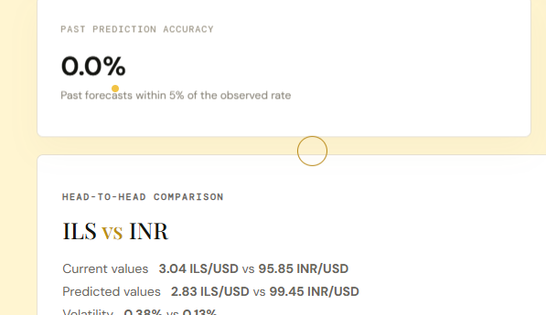
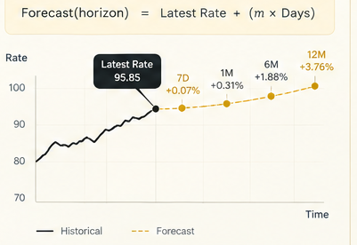
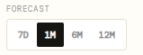
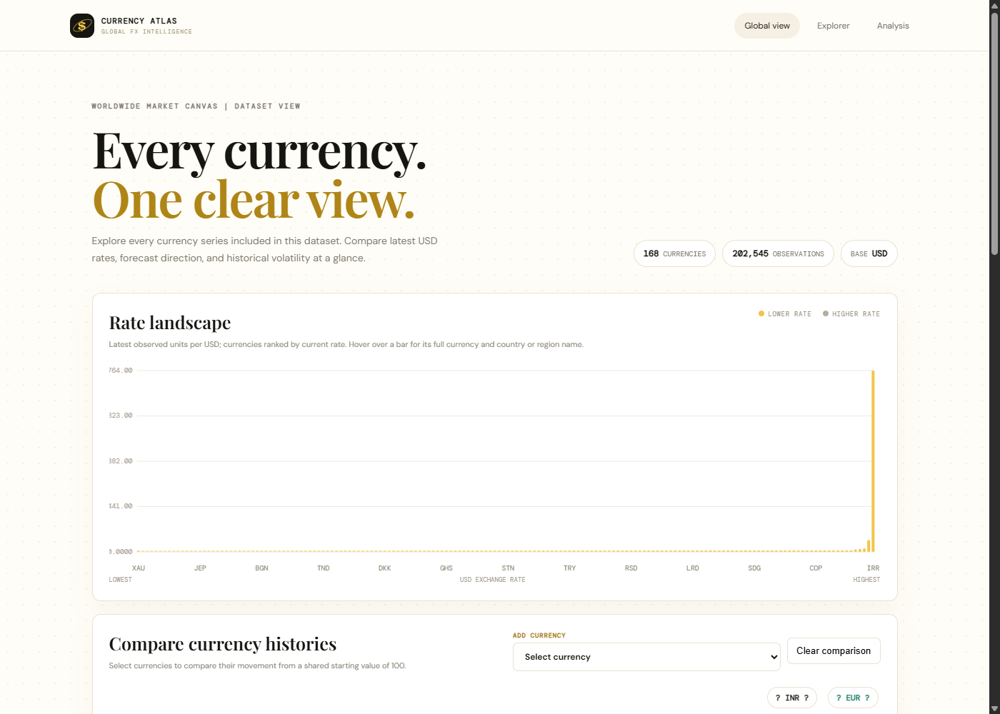

# Currencies-of-the-worlds

An interactive world currency analytics, historical tracking, and multi-horizon forecasting dashboard built with Python and modern web technologies.

---

## 📸 Screenshots & Page Previews

### 1. Main Currency Dashboard
Comprehensive overview showing real-time selection, key financial metrics, currency strength, and historical charting.


---

### 2. Multi-Horizon Forecasting Engine
Linear regression (OLS) trend analysis anchored to the latest exchange rate with milestones for **7 Days (7D)**, **1 Month (1M)**, **6 Months (6M)**, and **1 Year (12M)**.



---

### 3. Historical Trends & Interactive Charting
Interactive timeframes (**1Y**, **5Y**, **ALL**) with dynamic tooltips and volatility metrics.



---

### 4. Backtesting Accuracy & Head-to-Head Comparison
Rolling-window evaluation measuring historical forecast accuracy against a ±5% tolerance band, alongside direct head-to-head currency pairing.



---

### 5. All Currencies Directory Page (`/all-currencies.html`)
Full directory cataloging all 140+ global currencies, current exchange rates, and historical statistics.



---

## 🚀 Features

- **Global Coverage**: Real historical FX data covering 140+ world currencies against the USD from 2004 to present.
- **Interactive Multi-Horizon Forecasting**:
  - Linear regression (OLS) trend analysis with anchored projections.
  - Multi-milestone forecast callouts for **7 Days (7D)**, **1 Month (1M)**, **6 Months (6M)**, and **1 Year (12M)**.
- **Historical Charting**:
  - Interactive charts with flexible timeframes (**1Y**, **5Y**, **ALL**).
  - Volatility indices, min/max statistics, and currency strength indicators.
- **Backtesting & Accuracy**:
  - Rolling window evaluation measuring past forecast accuracy within a ±5% tolerance band.
- **Head-to-Head Comparison**: Compare historical trajectories, trends, and volatility across any pair of currencies.
- **Purchasing Power Insights**: "$1 USD Worldwide" section highlighting relative real-world value.
- **Fast Local REST API**: In-memory caching (`@lru_cache`) delivering sub-10ms response times without third-party API rate limits.

---

## 🛠️ Tech Stack

- **Backend**: Python 3.10+ (Standard Library `http.server` / REST endpoints, `numpy`, `pandas`)
- **Frontend**: Vanilla JavaScript (ES6+), HTML5 Canvas, SVG visualizers, Modern CSS
- **Data**: Curated historical daily FX exchange rates dataset (`cleaned_currency_data.csv`)

---

## 📦 Getting Started

### 1. Clone the repository
```bash
git clone https://github.com/kanchanc03-momo/Currencies-of-the-worlds.git
cd Currencies-of-the-worlds
```

### 2. Run the Server
Launch the application using Python:
```bash
python final/server.py
```
*(or `py final/server.py` on Windows)*

### 3. Open in Browser
Visit the dashboard at:
```
http://localhost:8000
```
Or explore the all-currencies directory at:
```
http://localhost:8000/all-currencies.html
```

---

## 📁 Project Structure

```
Currencies_of_Worlds/
├── cleaned_currency_data.csv    # Daily FX exchange rate dataset
├── screenshots/                 # Screenshots of each page and feature
│   ├── dashboard_overview.png
│   ├── dashboard_full_page.png
│   ├── forecast_milestones.png
│   ├── historical_trends.png
│   ├── prediction_accuracy_comparison.png
│   ├── all_currencies.png
│   └── all_currencies_full.png
├── final/
│   ├── app.py                   # REST API backend and forecast logic
│   ├── server.py                # HTTP server launcher
│   ├── index.html               # Main interactive dashboard UI
│   ├── all-currencies.html      # Comprehensive currencies overview
│   ├── currency_metadata.py     # Currency metadata and symbols
│   └── data_loader.py           # Data ingestion and preprocessing
├── backend/                     # Modular backend components
└── README.md                    # Project documentation
```
